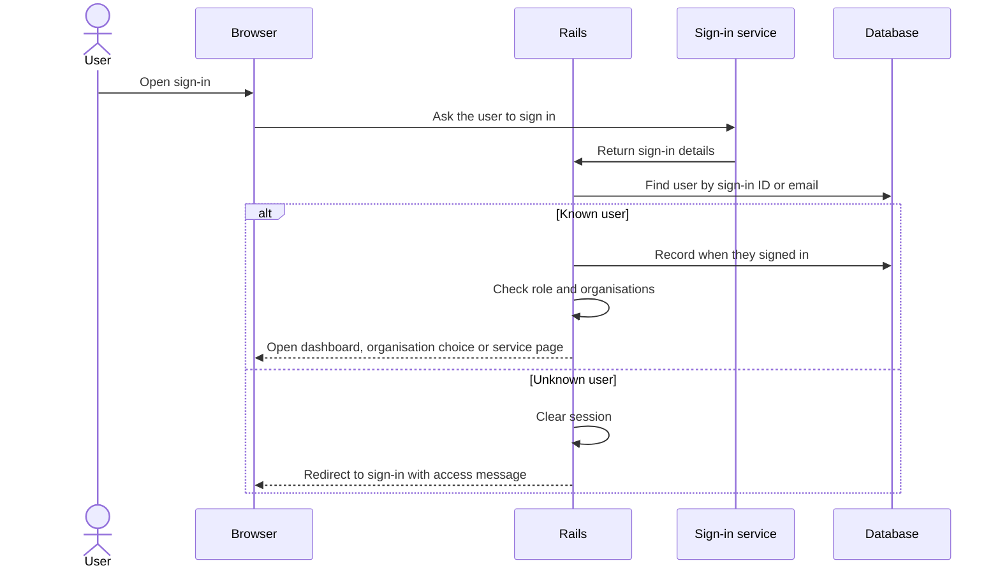
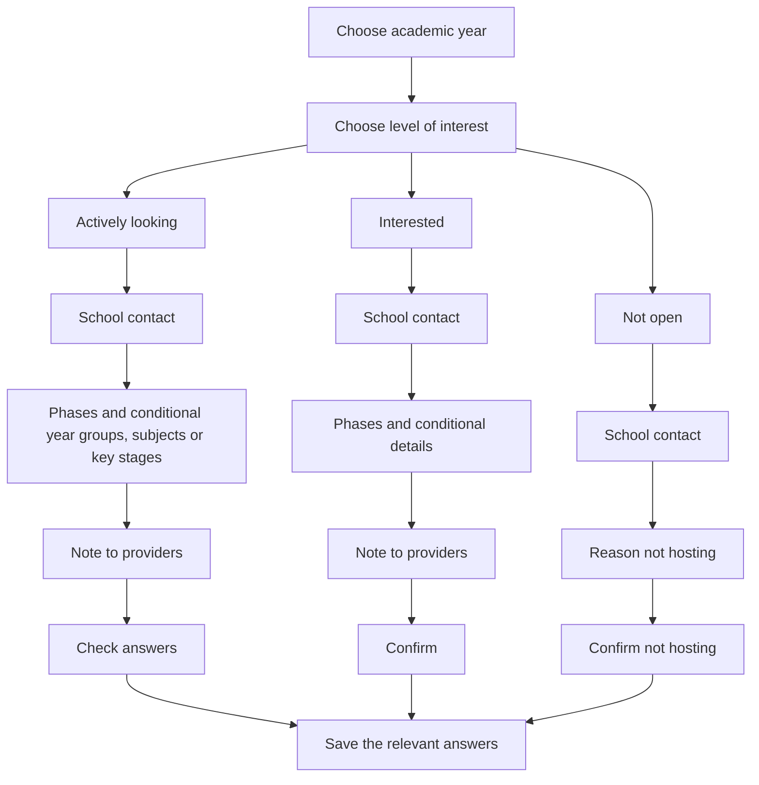

# Application flows: what users can do

Schools publish their interest in hosting placements. Providers search for schools. Admins help users and upload data.
A membership gives a user access to an organisation; it does not mean they have arranged a placement.

## Sign-in and organisation selection

The service checks who someone is, then checks whether they have access here. Real sign-in uses DfE Sign-in;
developers can use made-up test identities called personas. A setting, `SIGN_IN_METHOD`, chooses between them.
A failed DfE Sign-in does not switch the user to a persona.

The service remembers a signed-in visit in a session. After two hours without activity, the user needs to sign in again.



If a regular user belongs to one organisation, the service chooses it. If they belong to several, it asks them to choose.
Admins without a selected organisation see the dashboard. A school with no preferences is asked to add one; other schools
see their preferences. Providers see the school search.

The organisation choice is saved against the user, so changing it in one tab can affect another tab. Choosing a provider
can also send a feedback survey if one has not already been recorded as sent.

For developers: this behaviour is in [OrganisationRedirectable](../app/controllers/concerns/organisation_redirectable.rb)
and [SessionsController](../app/controllers/sessions_controller.rb). Read the
[sign-in code warning](architecture.md#identity-and-organisation-boundaries) before changing it.

## Hosting preferences

Schools say how interested they are in hosting for an academic year. The code calls this their `appetite`:

- **Actively looking** (`actively_looking`): ready to discuss placements, with contact and teaching details.
- **Interested** (`interested`): interested but may not yet know all the details.
- **Not open** (`not_open`): not hosting, with contact details and a reason.



The questions change to fit earlier answers. For example, a school interested in secondary teaching sees subject
questions, while primary teaching uses year groups. The diagram summarises those choices rather than showing every page.

Contact details can be saved before the final confirmation. Leaving a form unfinished therefore does not always mean
nothing has been saved. At the end, the service checks the answers and keeps those relevant to the chosen questions.
Creating a preference also schedules a feedback email and clears the form's temporary progress.

For developers: [AddHostingInterestWizard](../app/wizards/add_hosting_interest_wizard.rb) and
[PlacementPreferenceCreatable](../app/wizards/concerns/placement_preference_creatable.rb) choose the questions.
Some interested options allow `unknown`; check the step's rules before adding values.
`save_contact_details` can save during wizard setup. [EditHostingInterestWizard](../app/wizards/edit_hosting_interest_wizard.rb)
starts editing from the stored answers.

## Wizard state and JSONB

A **wizard** is a form spread across several pages. The service remembers the answers as the user moves forwards
or backwards. If an answer needs correcting, it keeps the user on that question.

### For developers: how answers are saved

[WizardController](../app/controllers/concerns/wizard_controller.rb) gives each form a generated state key in its URL
and copies progress into the database-backed session after each action.
[BaseWizard](../app/wizards/base_wizard.rb) works out the next/back step from the questions currently needed.

Completed preference answers are stored as **JSONB**, a database format for flexible, named groups of values.
Here is a made-up **part** of a preference, not a complete valid submission:

```json
{
  "appetite": { "appetite": "actively_looking" },
  "school_contact": {
    "first_name": "Example",
    "last_name": "Contact",
    "email_address": "placements@example.org"
  },
  "phase": { "phases": ["secondary"] },
  "secondary_subject_selection": {
    "subject_ids": ["00000000-0000-0000-0000-000000000001"]
  }
}
```

The long subject identifier is an example; replace it with an existing subject in your local database for a test.
Names such as `phase` and `secondary_subject_selection` tell search and display code where to find answers.
Follow-up subject steps include the selected subject's identifier in their name.

The database does not check these subject links against `placement_subjects`. If you change step names or answer
structure, plan how old preferences and unfinished forms will still work.

## Provider search

Providers can search by school name, school number (URN), postcode, year, hosting interest/history, teaching phase,
subject and location.

Without a location, the usual order is actively looking, interested, hosted last year, other schools, then not open.
School names break ties. Location searches use distance; travel-time information is added separately.

### For developers: search details and current limits

[SchoolsQuery](../app/queries/schools_query.rb) implements the filters and sorting:

- Phase and subject answers are read from `phase.phases` and `secondary_subject_selection.subject_ids` in JSONB.
- Location search caps the radius value at 50 and uses the geocoder's distance order. It does not filter by travel time.
- `previously_hosted` means any history before the selected year; the default ranking uses just the previous academic year.
- Filtering by year includes schools with a preference for that year or no preference record at all. It is not simply
  each school's latest preference.
- If the hosting filter finds no matching identifiers, the current code leaves the existing results unchanged rather
  than returning no schools. Some visible results may therefore not match that filter.

Check the query tests and stored answer paths when changing these rules.

## Academic years

Academic years run from 1 September to 31 August. The service creates a year record when it needs one, so support does
not need to add the next year manually.

For developers: [AcademicYear](../app/models/academic_year.rb) uses `for_date` for this lookup/creation.
`current`, `next` and `previous` call it. `for_display` offers this year and next year, plus a third year in June.
Reminders concern next year's preference, not necessarily the year the user last opened.

## Admin and support journeys

Admins can choose an organisation to help, add or remove users, add admins and upload files for user access or past
placements. The [upload guide](runbooks/data-imports.md) explains the file formats, what can be skipped and how to check
the result.

Data & Insights supplies Register information; support uploads it. This adds past-placement records, not bookings.
For developers: [policies](../app/policies/) and admin controllers check each action's permissions. Hiding a link alone
is not an access check.
