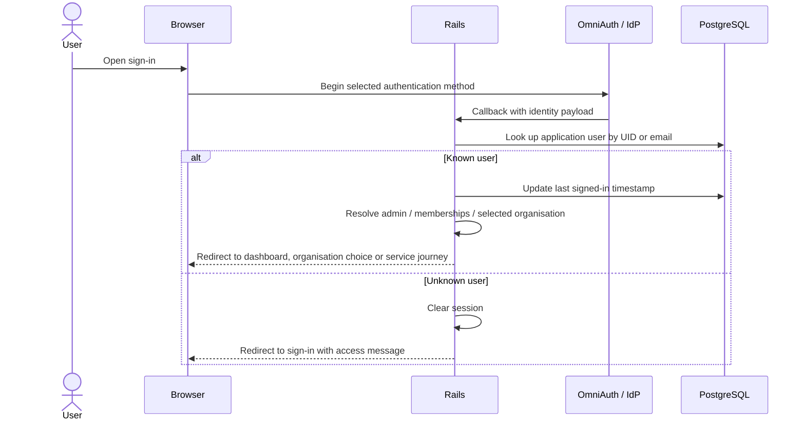
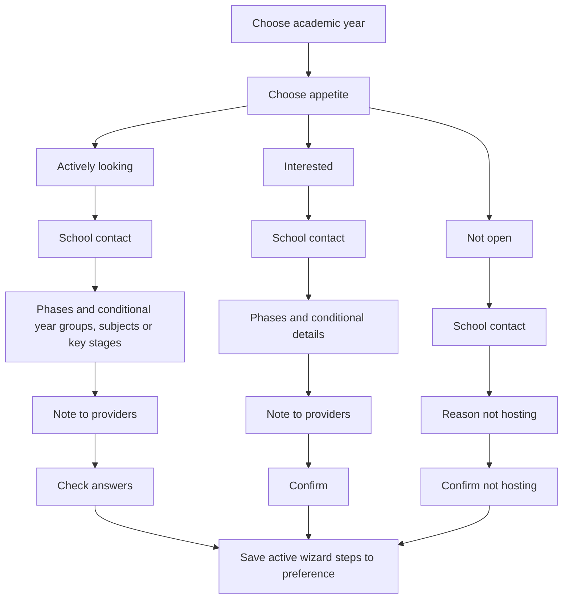

# Application flows

The service has school, provider and admin journeys. An organisation membership controls where a user can work; it does not represent a placement.

## Sign-in and organisation selection

`SIGN_IN_METHOD` selects personas or DfE Sign-in. It is not a fallback if DfE Sign-in fails. The application session model uses a two-hour inactivity timeout.



For regular users with one organisation, the redirect concern selects it. With several organisations, it asks the user to choose. Admins without a selected organisation go to the dashboard. Schools with no preferences are directed into preference creation; other schools see their preferences; providers see the school-search interface.

The selected organisation lives on `User`, not just in the session. Provider selection can trigger a feedback survey if the user has not already been marked as sent one. Consult [OrganisationRedirectable](../app/controllers/concerns/organisation_redirectable.rb), [SessionsController](../app/controllers/sessions_controller.rb) and the [authentication caveat](architecture.md#identity-and-organisation-boundaries) before modifying this behaviour.

## Hosting preferences

Schools record their appetite for a particular academic year:

- `actively_looking`: ready to discuss placements, with contact, phases and relevant details.
- `interested`: interested in hosting, with less definite selections where supported.
- `not_open`: not hosting, with contact and reason/confirmation steps.



This is a summary, not an exhaustive map of every conditional child-subject page. [AddHostingInterestWizard](../app/wizards/add_hosting_interest_wizard.rb) defines the branches; [PlacementPreferenceCreatable](../app/wizards/concerns/placement_preference_creatable.rb) builds phase-dependent steps. `unknown` is a supported option in some interested selections; consult each step's validation before adding a new value.

Contact information can be saved before the final confirmation: wizard initialisation calls `save_contact_details` when a populated contact step is present. Do not assume an abandoned wizard has made no database changes. Final save validates the assembled steps, stores only populated active-step state, and the create controller queues a feedback email and resets wizard state. Editing reuses the saved preference details through [EditHostingInterestWizard](../app/wizards/edit_hosting_interest_wizard.rb).

## Wizard state and JSONB

[WizardController](../app/controllers/concerns/wizard_controller.rb) uses a generated state key in the URL and stores a copy of wizard state in the database-backed session after each action. [BaseWizard](../app/wizards/base_wizard.rb) determines the next/back step from the current conditional step list. Invalid input re-renders the step rather than advancing.

The following is a synthetic **fragment**, not a complete valid preference:

```json
{
  "appetite": { "appetite": "actively_looking" },
  "school_contact": {
    "first_name": "Example",
    "last_name": "Contact",
    "email_address": "placements@example.org"
  },
  "phase": { "phases": ["secondary"] },
  "secondary_subject_selection": {
    "subject_ids": ["00000000-0000-0000-0000-000000000001"]
  }
}
```

The subject UUID is illustrative and must be replaced with a real local subject for a test. Root step keys determine how details are consumed by search and presentation. Child-subject steps have keys that include the selected subject identifier. There is no database FK from these arrays to `placement_subjects`. Changing a step name or JSON shape therefore needs a compatibility plan for existing preferences and in-progress sessions.

## Provider search

[SchoolsQuery](../app/queries/schools_query.rb) combines name/URN/postcode, academic-year, hosting appetite/history, phase, subject and location filters.

- Phase and subject filters read `phase.phases` and `secondary_subject_selection.subject_ids` inside JSONB.
- Location search caps the radius at 50 and orders by the geocoder's distance result. Travel-time enrichment is separate; it is not the distance-filter calculation.
- Without location coordinates, ranking is: actively looking, interested, hosted in the previous academic year, other schools, then not open; names break ties.
- The `previously_hosted` filter considers history before the selected year, whereas the ranking check uses the previous academic year.
- The academic-year condition includes schools with a matching preference or no preference row at all; do not describe it as an unrestricted view of every school's latest preference.
- If hosting-filter lookup produces no IDs, the current query returns the existing scope rather than an empty result. This is observed behaviour, not a promise that every visible result satisfies that filter.

Avoid changing search documentation based on intended behaviour alone: check query specs and the SQL/JSON paths.

## Academic years

[AcademicYear](../app/models/academic_year.rb) defines 1 September through 31 August. `for_date` finds the year covering a date or creates it on demand. `current`, `next` and `previous` use that method; no annual manual year-creation runbook is required.

`for_display` returns the current year and following year, with a third year shown in June. Reminders target `AcademicYear.next`, not necessarily the year a user last viewed.

## Admin and support journeys

Admin users can switch organisation context, add/remove users, onboard school/provider users by CSV, add admins and import previous-placement data. Use the [import runbook](runbooks/data-imports.md) for input formats, partial-failure behaviour and verification.

Data & Insights supplies Register placement information; support uploads it. The code creates historical records, not trainee bookings. Permission checks are action-specific in [policies](../app/policies/) and admin controllers, so verify them when adding a route rather than relying only on hidden navigation.
