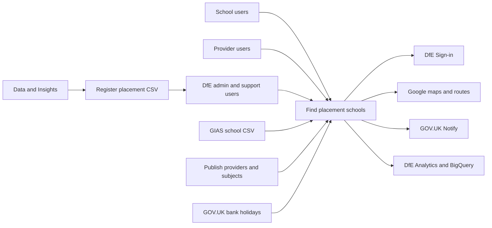
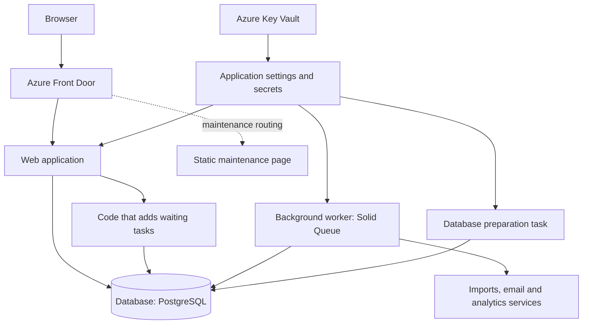

# Architecture: how the service fits together

Find placement schools helps schools publish their willingness to host initial teacher training placements and helps providers find potential partner schools. It does not allocate trainees or book placements.

This guide explains the main parts of the service and what each does. You do not need to recognise every tool name:
the important distinction is between the part that shows pages, the part that runs tasks in the background and the
database where they keep information.

Start with the [handover guide](../handover-document.md) for a reading path and glossary.
Read [application flows](application-flows.md) for what users do and [deployment](deployment.md) for how we release changes.

## System context

Rails, the web framework we use, builds pages and sends them to the user's browser. The browser also asks the service
for information needed to display maps. Schools and providers mainly use pages and forms, rather than a separate data
service for other organisations to connect to.

The diagram shows the people and other services involved. Information about past placements arrives as a file uploaded
by support; we do not fetch it directly from Register trainee teachers.

Arrows show who uses the service and where information travels. They do not show who has permission to access each
system. See [integrations](integrations.md) for what we use each service for and what happens if it fails.

## Runtime

The hosted service has three main parts:

- The **web application** responds when someone opens a page or submits a form.
- The **worker** handles waiting tasks, such as imports and emails, without keeping the user's page open.
- The **database** stores school/user information, sign-in and form progress, and waiting tasks.

Azure Kubernetes Service (AKS) is the hosting platform that runs the web application and worker.
Terraform files describe how those resources should be set up. Azure Front Door receives visits and directs them
to the application, or to a maintenance page when we need one.

The box for adding waiting tasks is code (the "queue adapter"), not another server.
The live service uses Azure's managed PostgreSQL database. Temporary review copies use a database running within
the hosting platform instead.

When we release a change, shared automation sets up the new version. A separate migration task prepares any database
changes. Key Vault keeps secret settings, which are passed to the parts that need them rather than stored in this code.

Sources: [application Terraform](../terraform/application/application.tf), [database Terraform](../terraform/application/database.tf), [migration job](../terraform/application/job.tf), [deployment workflow](../.github/workflows/build-and-deploy.yml).

## Main implementation choices

### For developers: tools and their roles

The names below help you find the relevant code and settings. The explanation is more important than memorising the names.

| Part | Tools and purpose |
| --- | --- |
| Web pages | Rails builds the pages, Puma handles web requests, and ERB templates/GOV.UK components control how pages look. |
| Browser behaviour | Stimulus and GOV.UK Frontend add page interactions. esbuild and Sass prepare JavaScript/styles; Propshaft serves the resulting files. |
| Stored information | PostgreSQL is the database. Records have UUID identifiers. Schools/providers share a table (STI); preference answers use flexible JSONB storage. See the [data guide](data-model.md). |
| Checking who someone is | OmniAuth connects to DfE Sign-in using OpenID Connect, a standard sign-in protocol. Developers can select test identities called personas instead. |
| Checking what someone may do | Pundit rules and admin checks control permissions for the selected organisation. |
| Remembering a visit | `activerecord-session_store` keeps session information in the database, including unfinished forms. |
| Background tasks | Active Job adds work to Solid Queue. A separate worker runs those tasks on the hosted service. |
| Viewing tasks | Admins use Mission Control Jobs at `/jobs` to see waiting and failed work. |
| Remembering travel results | `Rails.cache` can reuse travel times. Production does not explicitly set up a shared store, so different copies of the application may not reuse each other's results. |
| Finding problems | Logs, Sentry error reports and health checks help diagnose failures; see [operations](operations.md). |
| Hosting | Shared AKS/Terraform setup, rather than Kamal. |

`solid_cache` and `kamal` are listed as dependencies in the [Gemfile](../Gemfile), but are not set up for these roles.
There are no Solid Cache tables in the database structure. For current software versions, check the dependency files
and [tool versions](../.tool-versions), which are easier to keep up to date than copies in this guide.

## Code map

Developers can use this table to find the part to change. You can skip it if you only need the service overview.

| Location | Responsibility |
| --- | --- |
| [Controllers](../app/controllers/) | Respond to page requests, check sign-in and move users through forms |
| [Models](../app/models/) | Describe records, their connections and the rules for saving them |
| [Policies](../app/policies/) | Check permission for each action |
| [Wizards](../app/wizards/) and [forms](../app/forms/) | Decide which questions to show and check the answers |
| [Queries](../app/queries/) | Find, filter and sort schools/providers |
| [Services](../app/services/) and [lib](../lib/) | Carry out tasks such as imports, travel calculations and notifications |
| [Jobs](../app/jobs/) and [mailers](../app/mailers/) | Run background tasks and prepare emails |
| [Decorators](../app/decorators/), [presenters](../app/presenters/) and [components](../app/components/) | Prepare information for display |
| [JavaScript](../app/javascript/) and [assets](../app/assets/) | Add browser interactions, maps and styles |
| [Configuration](../config/) | Set up the application, page addresses, scheduled tasks and analytics |
| [Specs](../spec/) | Automated tests, made-up test data and email previews |
| [Terraform](../terraform/) and [workflows](../.github/workflows/) | Describe hosting and automate releases/maintenance |

## Identity and organisation boundaries

DfE Sign-in checks someone's identity, but the person must also have a user record in this service. A membership
connects them to a school or provider. People with several memberships can choose which organisation to work with.
The choice is saved against their user record, so changing organisation in one tab can affect another tab too.
Admins have separate pages for switching organisations.

### For developers: permission checks

[ApplicationController](../app/controllers/application_controller.rb) normally requires sign-in. If a Pundit permission
check fails, it sends the user back with a message. [AdminController](../app/controllers/admin_controller.rb) returns
HTTP 403 ("forbidden") for signed-in users who are not admins. Check the rule for the specific action when making changes.

Two files define the same Ruby class, `DfeSignInUser`: the [model](../app/models/dfe_sign_in_user.rb) and a
[service](../app/services/dfe_sign_in_user.rb). They expect different inputs and session fields. The model has the user
lookup the controller calls. Check how Rails loads these files and the [sign-in tests](../spec/models/dfe_sign_in_user_spec.rb)
before changing them; the duplication is not fixed by this documentation.

## Decisions and documentation boundaries

The [decision records](../adr/) explain why the team chose shared organisation storage, flexible preference answers,
multi-page forms and Solid Queue. The original data diagram records an early design; use the [data guide](data-model.md)
for the current structure.

This guide describes the code and settings. It does not show that other services are currently available or that recovery
has been practised. Dashboard information, reports, policies and incident guidance stay in Confluence, without copies
or links here.
