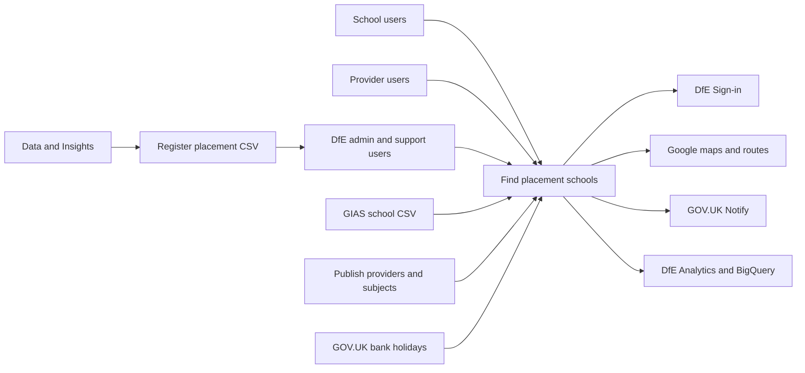
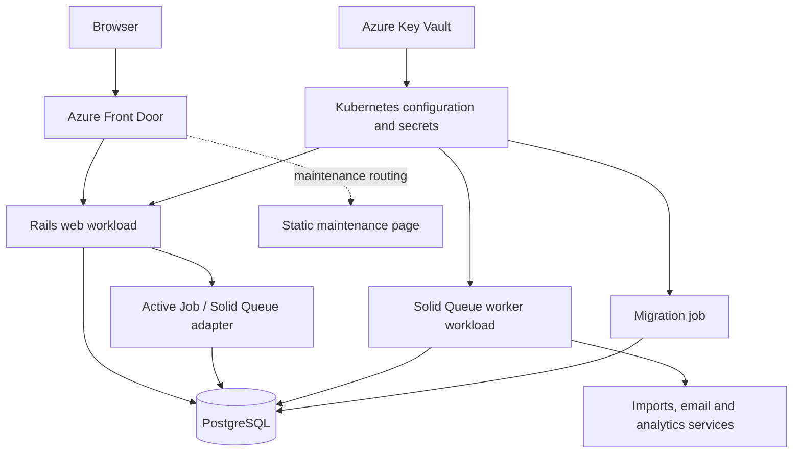

# Architecture

Find placement schools helps schools publish their willingness to host initial teacher training placements and helps providers find potential partner schools. It does not allocate trainees or book placements.

Start with the [handover guide](../handover-document.md). Read [application flows](application-flows.md) for user journeys and [deployment](deployment.md) for environment and release details.

## System context

The application is a server-rendered Rails service, with a small internal JSON endpoint for its map view. Register data arrives through a support upload, not a live API.

Arrows show user access or the direction of data/request flow, not network permissions. See the [integration register](integrations.md) for contracts and failure behaviour.

## Runtime

Terraform defines separate web and worker workloads on Azure Kubernetes Service (AKS). The database stores business data, sessions and Solid Queue state.

The queue box is an application adapter, not another server or database. Production uses an Azure PostgreSQL flexible server; review apps use an in-cluster database. The shared deployment action orchestrates rollout; the application repository declares the migration job and web/worker configuration.

Sources: [application Terraform](../terraform/application/application.tf), [database Terraform](../terraform/application/database.tf), [migration job](../terraform/application/job.tf), [deployment workflow](../.github/workflows/build-and-deploy.yml).

## Main implementation choices

| Concern | Implementation |
| --- | --- |
| Web application | Rails, Puma and server-rendered ERB; GOV.UK components and form builder |
| Browser behaviour | Stimulus, GOV.UK Frontend, esbuild and Sass; Propshaft serves built assets |
| Data | PostgreSQL, UUID business identifiers, organisation single-table inheritance (STI) and JSONB preference details |
| Authentication | OmniAuth OpenID Connect for DfE Sign-in; developer personas selected by configuration |
| Authorisation | Pundit policies plus admin-controller checks; users work in a selected organisation |
| Sessions | `activerecord-session_store` in the application database, including wizard state |
| Background work | Active Job with Solid Queue in production; dedicated hosted worker |
| Queue UI | Mission Control Jobs at `/jobs`, using `AdminDashboardController` |
| Cache | `Rails.cache` is used for travel times. Production does not explicitly configure a durable/shared cache store. Do not assume caching is shared across replicas. |
| Logging and health | Semantic logging/Logit, Sentry, OkComputer and Rails `/up`; see [operations](operations.md) |
| Hosting | AKS/shared DfE Terraform modules, not Kamal deployment |

`solid_cache` and `kamal` appear in the [Gemfile](../Gemfile), but their presence is not evidence that they are used. There are no Solid Cache tables in the current schema. Read the manifests and [tool versions](../.tool-versions) rather than relying on versions copied into prose.

## Code map

| Location | Responsibility |
| --- | --- |
| [Controllers](../app/controllers/) | HTTP entry points, authentication, selected-organisation context and wizard orchestration |
| [Models](../app/models/) | Data relationships, validations and domain scopes |
| [Policies](../app/policies/) | Pundit permission rules; review the action-specific rule rather than assuming a uniform role matrix |
| [Wizards](../app/wizards/) and [forms](../app/forms/) | Multi-page input and branch-specific validation |
| [Queries](../app/queries/) | School/provider search, filtering and ordering |
| [Services](../app/services/) and [lib](../lib/) | Imports, external clients, travel time and user notifications |
| [Jobs](../app/jobs/) and [mailers](../app/mailers/) | Asynchronous execution and notification templates |
| [Decorators](../app/decorators/), [presenters](../app/presenters/) and [components](../app/components/) | Presentation logic |
| [JavaScript](../app/javascript/) and [assets](../app/assets/) | Browser controllers, maps and styles |
| [Configuration](../config/) | Rails environments, routes, recurring work, analytics field configuration and initializers |
| [Specs](../spec/) | Behaviour checks, factories, support helpers and mail previews |
| [Terraform](../terraform/) and [workflows](../.github/workflows/) | Infrastructure declaration and delivery/operational automation |

## Identity and organisation boundaries

Users must already have an application user record; a successful DfE Sign-in alone does not grant service access. Memberships link users to schools/providers. The selected organisation is stored on the user record, so it is not an independent context per browser tab. Admin users can use the admin organisation-switching routes.

[ApplicationController](../app/controllers/application_controller.rb) enforces sign-in by default and handles Pundit denials with a flash message and redirect. [AdminController](../app/controllers/admin_controller.rb) returns 403 for signed-in non-admin users. Individual controllers/policies determine further access.

There are two files defining `DfeSignInUser`: the [model](../app/models/dfe_sign_in_user.rb) and a [service with the same constant](../app/services/dfe_sign_in_user.rb). They differ in session fields and method signatures. The model contains the user lookup used by the controller. Check autoloading and [authentication specs](../spec/) before changing this area; this documentation does not resolve that pre-existing duplication.

## Decisions and documentation boundaries

The [ADRs](../adr/) explain the confirmed rationale for STI, JSONB, wizards and Solid Queue. The historical initial data model is not the current ERD: use the [data model](data-model.md).

This is an implementation reference, not a claim that external services are reachable or that recovery has been rehearsed. Dashboard information, assurance reports, policies and incident guidance are maintained in Confluence and are not reproduced or linked here.
