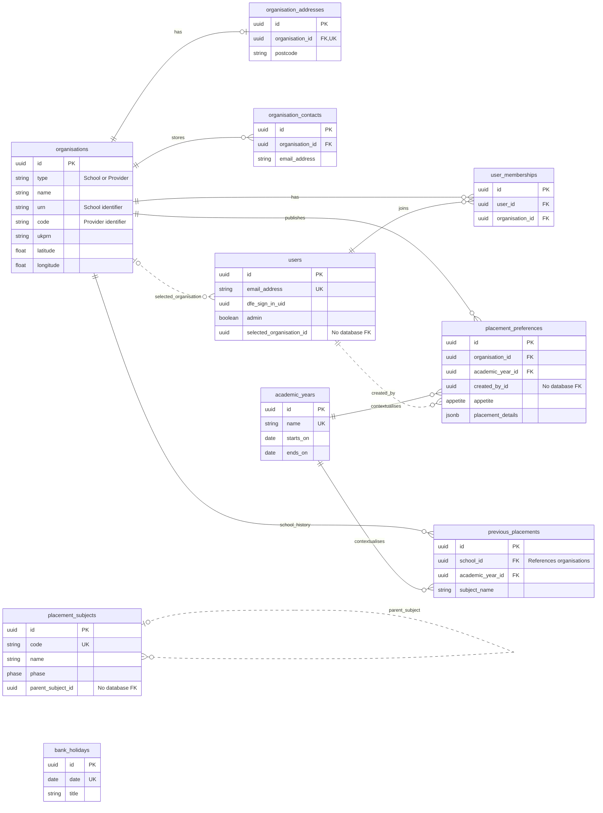
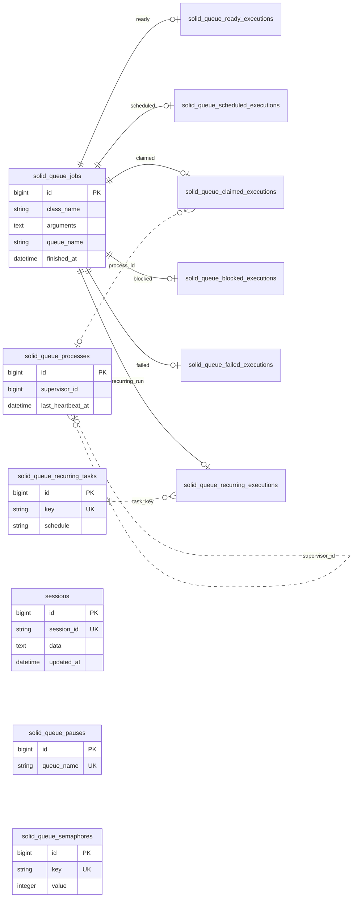

# Data model

The service stores organisation membership, schools' hosting preferences and historical evidence of placements. A preference is not a booked placement, and a previous-placement record does not identify a trainee.

The authoritative structure is [db/schema.rb](../db/schema.rb). Model behaviour is in [app/models](../app/models/). [ADR 00002](../adr/00002-initial-data-model.md) records the original design, not today's complete schema.

## Business ERD

This diagram shows database foreign-key relationships with solid lines. Dotted lines show model/application links without a database foreign key. Columns are selected identifiers and domain fields, not a full schema dump.

`bank_holidays` is independent; it supports email scheduling rather than placement relationships. `School` and `Provider` are Ruby subclasses of `Organisation`, not additional tables. Subject IDs inside JSONB are application links, not relational joins.

## Important invariants and limits

| Data | Meaning and enforcement |
| --- | --- |
| Organisations | `name` is required. `type` implements STI. School URN and provider code are required/unique in their respective models; partial unique indexes constrain School URN and Provider `(type, code)`. Do not treat UKPRN as unique. |
| Addresses | `organisation_id` is non-null, a FK and unique: at most one address per organisation. An organisation need not yet have an address. |
| Contacts | The model declares `has_one`, but the schema permits several contacts per organisation. Email and organisation are non-null. Contact information also appears in preference JSONB; it is not automatically a FK to this table. |
| Users | Names and email are required; email is normalised and database-unique. `dfe_sign_in_uid` is nullable and not uniquely indexed. `selected_organisation_id` is optional and has no FK. |
| Memberships | Both FKs are non-null. There is no unique composite database index on `(user_id, organisation_id)`; do not assume the database prevents duplicate memberships. |
| Preferences | Organisation, academic year and creator IDs are non-null; only the first two have FKs. `appetite` is validated by the model as `actively_looking`, `interested` or `not_open`; the column itself allows null. No database uniqueness constraint guarantees one preference per organisation/year. |
| JSONB details | Variable, step-keyed data. Step objects/wizards validate it; the `PlacementPreference` model does not define a full JSON schema. See [application flows](application-flows.md). |
| Subjects | `phase` is `primary` or `secondary`. Codes are database-unique when present; parent IDs have an index but no FK. SEND is a preference phase, not a subject enum value. |
| Previous placements | School and year are non-null FKs. Subject is stored as text, not a subject FK. Model uniqueness covers school, subject name and year, but there is no corresponding database unique index. |
| Academic years | Name and dates are required; names are database-unique. The model checks end date is not before start date. See [year selection](application-flows.md#academic-years). |
| Bank holidays | Date is required and unique; title is required. The sync imports England and Wales events. |

Organisation fields also hold school characteristics, contact channels and coordinates imported from GIAS/Publish. The schema is the field dictionary for those imported attributes; mapping code is in the [GIAS importer](../app/services/gias/csv_importer.rb) and [provider importer](../app/services/publish_teacher_training/provider/importer.rb).

## Deletion is not a retention policy

School and academic-year models destroy associated previous placements; deleting a parent subject destroys its child subjects through the model. Other associations do not provide a universal cascading delete. Foreign keys can block removal, and `delete_all` bypasses model callbacks.

In particular, the GIAS importer attempts to delete schools absent from the source that have no preferences. Existing foreign-key references can still prevent deletion. Do not infer a general cleanup or retention guarantee from this import.

Use the supported admin/service flows for membership removal. [Users::Remove](../app/services/users/remove.rb) removes the membership and enqueues a notification; it is not a complete user-data erasure process. Retention and related policy material are maintained in Confluence.

## Framework storage

These are operational tables in the same schema/database, not extra domain entities. Restoring this database also restores session and queued-work state.

The six execution tables each have a unique `job_id` FK with database cascading deletion when their job is deleted. This diagram omits their repeated columns. Pauses and semaphores hold queue/concurrency state; dotted process/task links are not database FKs. Sessions contain authentication and unfinished wizard data and must be treated as sensitive.

## Maintaining this guide

When changing a migration, model association, JSONB step or import mapping, update the affected diagram, invariant and example in the same change. Do not edit the schema to match the diagram: migrations and Rails schema generation remain authoritative.
