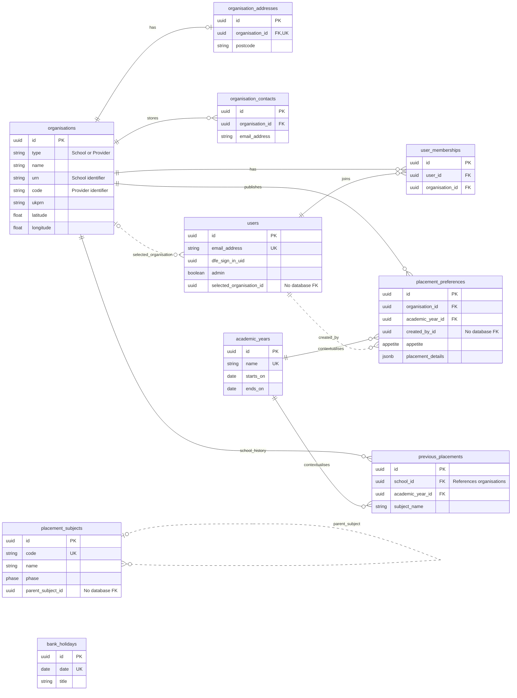
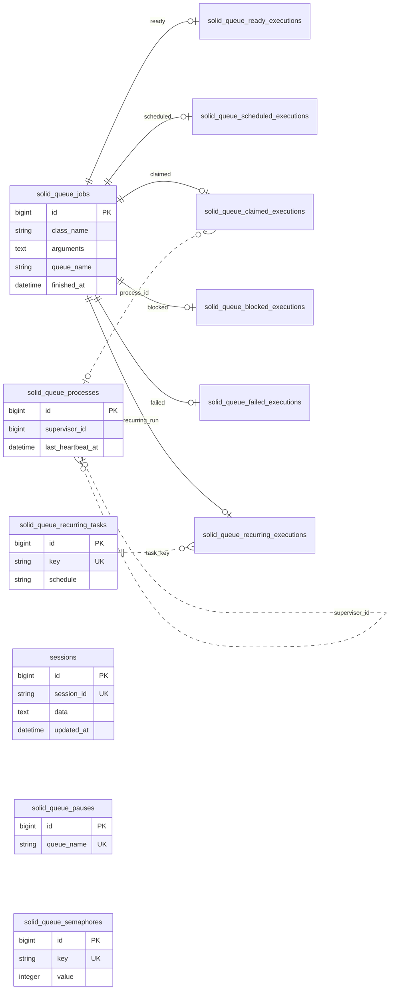

# Data model: what we store

The database keeps the information the service needs: schools, providers, users, who belongs to which organisation,
and what schools have said about hosting placements. It also keeps information about past placements.

A school's preference is not a booking. A past-placement record does not identify an individual trainee.

## The main connections

- A user can belong to more than one school or provider. Each connection is called a **membership**.
- Schools and providers share an **organisation** record, with extra details that depend on the type.
- A school's **placement preference** records its interest in hosting for an **academic year**.
- **Subjects** help describe the placements a school is interested in.
- **Previous placements** show past hosting by school, year and subject name.
- **Bank holidays** help decide when to send emails.

The diagram below shows these connections. The detailed table after it is for developers checking what the database
allows. [db/schema.rb](../db/schema.rb) is the source for the database structure; [models](../app/models/) add rules
in the application. The [original design record](../adr/00002-initial-data-model.md) is historical, not the current structure.

## Business ERD

An entity relationship diagram (ERD) is a map of stored information. Each box is a table: a collection of records of
the same kind. Lines show how records connect.

For developers reading the symbols:

- `PK` is a primary key: the record's own identifier. A UUID is a long unique identifier.
- `FK` is a foreign key: a link the database checks against another table.
- `UK` means the value must be unique when present.
- A circle means the connection is optional; a crow's-foot end means there can be many records.
- Solid lines here mark links checked by database foreign keys. Dotted lines mark links used by the code but not checked
  that way by the database. Some column names are left out to keep the diagram readable.

`bank_holidays` sits on its own because it helps with email timing, not school membership. `School` and `Provider` are
two types of `Organisation` in the code, rather than separate database tables.

Some preference answers are stored together as JSONB, a flexible set of named answers. Subject identifiers in those
answers are not database-checked links. See the [worked example](application-flows.md#wizard-state-and-jsonb).

## Important rules and limits

### For developers: rules and gaps

These are rules to bear in mind when changing data. A rule checked only by Ruby code may be bypassed by a direct database
update. "Required" means the value cannot be empty at the level described.

| Data | Rules and things to watch |
| --- | --- |
| Organisations | Need a name. The `type` field distinguishes schools/providers in the shared table, a pattern called single-table inheritance (STI). School URNs and provider codes must be present in their models; database rules prevent duplicates for the relevant type. UKPRN, another organisation identifier, is not guaranteed to be unique. |
| Addresses | The database allows at most one address per organisation and checks that the organisation exists. An organisation can have no address yet. |
| Contacts | The code expects one contact, but the database allows several. Each needs an email and organisation. Contact answers saved with a preference are separate from this table. |
| Users | Need names and an email. The email is tidied and must be unique. The DfE Sign-in identifier can be empty or repeated. The selected organisation is optional and has no database foreign key. |
| Memberships | Must link to an existing user and organisation. The database does not prevent two records for the same pair. |
| Preferences | Need organisation, year and creator IDs. Only organisation/year have database foreign keys. The code checks the interest level (`appetite`), but the database column can be empty. The database does not guarantee one preference per school/year. |
| JSONB details | Answers are grouped by form step. Those steps check the answers; the preference model does not define one complete fixed structure. See [application flows](application-flows.md). |
| Subjects | `phase` is primary or secondary. Subject codes must be unique when present. Parent-subject links are not checked by a database foreign key. SEND can be selected in a preference, but is not a subject phase value. |
| Previous placements | Must link to an existing school and year. The subject is a name, not a link to the subjects table. The code checks for duplicates by school/year/subject, but there is no matching database uniqueness rule. |
| Academic years | Need a name and dates. Names must be unique; the code checks the end is not before the start. See [year selection](application-flows.md#academic-years). |
| Bank holidays | Need a unique date and a title. The import uses England and Wales holidays. |

Organisation records also hold school details, contact information and map coordinates downloaded from GIAS and Publish.
Developers can see the full list in the schema and how values are copied in the
[school importer](../app/services/gias/csv_importer.rb) and [provider importer](../app/services/publish_teacher_training/provider/importer.rb).

## Deletion is not a retention policy

Deleting one record does not always delete everything connected to it. Through the models, deleting a school or academic
year also deletes its previous-placement records; deleting a parent subject deletes its child subjects. Other links
behave differently, and database checks can stop a deletion.

For developers: `delete_all` skips the model's automatic actions. The GIAS import uses it to try to remove schools
missing from the downloaded data that have no preferences. Other linked records can still stop that deletion.

Use the supported admin pages to remove membership. [Users::Remove](../app/services/users/remove.rb) removes that link
and schedules an email; it does not erase all information about the person. These behaviours are not a promise that
data is deleted after a particular period. Retention policies stay in Confluence.

## Framework storage

### For developers: tables that keep the application running

Alongside school and user records, the same database holds sign-in/form progress and background tasks. The tables below
track waiting, running, blocked and failed tasks. They are not additional placement records.

This matters during recovery: restoring the database brings back those tasks and sessions too.

Each of the six execution tables links to a task by a unique `job_id`. The database removes those execution records
when the task is deleted. Repeated columns are left out of the diagram.

Pauses record stopped queues. Semaphores help limit how many tasks run at once. The dotted process/task links are
not checked by database foreign keys. Sessions hold sign-in details and unfinished answers, so treat them as sensitive.

## Maintaining this guide

When changing stored data, its rules or an import, update the matching explanation, diagram and example.
Developers should make database changes through migrations (versioned database-change scripts), not by editing the
schema file to match this guide. Rails generates that file from the database.
