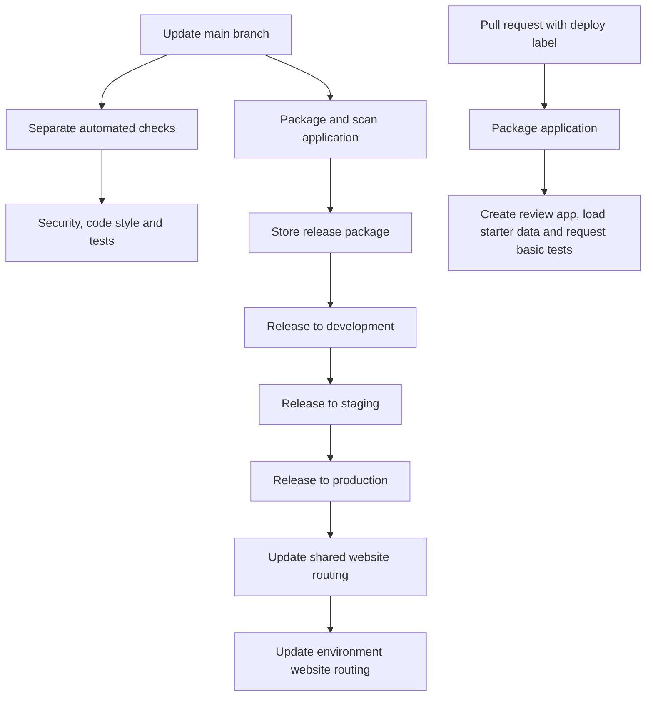

# Deployment: releasing changes

A deployment releases a version of the service to a hosted environment. An environment is a separate copy of the
service: production is the one real users use; the others help us check changes safely.

The release tools package the application, prepare the database and update the website and background worker.
We use the DfE shared Azure hosting platform for this.

The tables and commands below are for developers and people managing releases. They explain the saved settings,
not whether a live environment is healthy right now. If a release goes wrong, use the [recovery guide](runbooks/recovery.md).

## Environments

| Environment | Website address | Hosting group / application area (cluster / namespace) | Rails setting |
| --- | --- | --- | --- |
| Production | `find-placement-schools.education.gov.uk` | `production` / `bat-production` | `production` |
| Staging | `staging.find-placement-schools.education.gov.uk` | `test` / `bat-staging` | `staging` |
| Development | `development.find-placement-schools.education.gov.uk` | `test` / `bat-qa` | `az_development` |
| PR review | Generated in deployment output | `test` / `bat-qa` | `review` |

Sources: [application environment configuration](../terraform/application/config/), [domain configuration](../terraform/domains/environment_domains/config/) and [Rails environments](../config/environments/).

**Staging** is a place to check changes before production. A **review app** is a temporary copy for a pull request.
Both use the production Rails settings as a starting point. Hosted development starts from the development settings.

Production runs two copies of the website and has database high availability (extra support for keeping the database
running) and backup storage enabled. This helps reliability, but is not a promise about uptime or recovery time.

### For developers: differences between environments

The cluster/namespace columns tell you where to find the running application in Kubernetes, the hosting system.
Review apps use a database within that system rather than a separate Azure database, and disable database SSL.
Their setup loads starter data, including test personas, and can call GIAS/Publish. Never copy production data into them.

`SIGN_IN_METHOD` chooses real sign-in or personas. It is not set in the committed environment YAML files; if missing,
it defaults to personas. Check the effective setting through the approved access process rather than assuming
production-style Rails settings automatically choose DfE Sign-in.

## Release path



There are two separate automated processes. **Continuous integration (CI)** checks security, code style and tests.
**Build and Deploy** prepares and releases the application. In these workflow files, the release does not wait for CI
to finish. GitHub may have additional branch or approval rules, but those are not defined or checked here.

### For developers: release automation

Sources: [CI](../.github/workflows/ci.yml) and [Build and Deploy](../.github/workflows/build-and-deploy.yml).
The release package is a **container image**, stored at `ghcr.io/dfe-digital/find-placement-schools`.
The [Dockerfile](../Dockerfile) describes how to build it; the shared build action uses Snyk for scanning.
Releases run one environment at a time (`max-parallel: 1`): development, staging, then production.
A failure stops successful completion of the later release path.

The [database preparation job](../terraform/application/job.tf) defaults to `bundle exec rails db:prepare` through
[Terraform variables](../terraform/application/variables.tf). Check its logs as well as the website/worker update.
A running website does not show that every background task has completed.

Review releases ask for **smoke tests**, meaning basic checks that the new copy works. Development, staging and
production do not request those smoke tests in the workflow; they request a health check instead. This is not a full
test of a production user journey.

## Manual deployment and review lifecycle

For an approved manual release, Build and Deploy asks for:

- `environment`: review, development, staging or production.
- `docker-image-tag`: the label identifying an already-built release package.
- `pull-request-number`: required when releasing a review app.

A manual run uses that existing package; it does not build a new one. Before starting it, confirm permission, the
environment and whether that version can work with the current database. Afterwards, check `/healthcheck/sha`,
the database connection, the website and worker, and a representative user journey. Releasing an older version does
not undo database changes.

Pull requests labelled `deploy` get review apps. [Delete Review App](../.github/workflows/delete-review-app.yml) removes
them when a labelled pull request closes, or when given a PR number manually.
[The cleanup workflow](../.github/workflows/review-app-reconcile.yml) checks for old review apps on Sunday at 08:00 UTC
and deletes ones no longer needed. A manual run defaults to a dry run: it reports what it would do without deleting.
Do not keep anything important only in a review app.

[Build No Cache](../.github/workflows/build-nocache.yml) rebuilds the package on Sunday at 12:30 UTC without reusing
saved build steps. It stores the new package but does not release it.

## Infrastructure and configuration

### For developers: hosting files and settings

**Infrastructure** means the hosting resources the application needs. Terraform describes those resources in code,
so changes can be reviewed and applied consistently.

| Location | Responsibility |
| --- | --- |
| [terraform/application](../terraform/application/) | Website, background worker, database preparation, database, reporting and monitoring |
| [terraform/domains/infrastructure](../terraform/domains/infrastructure/) | Shared website names and Front Door routing |
| [terraform/domains/environment_domains](../terraform/domains/environment_domains/) | Addresses/routing for each environment and request-limit settings |
| [global_config](../global_config/) | Azure account/environment names and shared hosting module choices |
| [Makefile](../Makefile) | Shortcuts for previewing/applying hosting changes, connecting to the platform and maintenance tasks |

`application_configuration` passes ordinary and secret settings to the running application, using environment files,
Key Vault and values from other modules. Keep passwords, tokens and secret output out of source control and docs.
Changing a secret needs coordination with everything using it; an approved step-by-step rotation process is not
established here.

For authorised infrastructure work, these examples target development and production respectively:

```sh
make development terraform-plan
make production terraform-plan CONFIRM_PRODUCTION=yes
```

These commands preview proposed hosting changes, but **also change local setup**. Before showing the plan, they select
the Azure account, replace a local copy of shared code and set up Terraform's connection to saved resource information
(its state). Use the correct Azure subscription, permissions and tool versions.
Do not substitute `terraform-apply` (make changes) or `terraform-destroy` (remove resources) for a preview command.

[Validate Infra](../.github/workflows/validate-infrastructure.yml) runs daily at 07:00 UTC. It compares production hosting
with the saved settings for the application and website routing, then reports differences through Teams. It does not
release a change or demonstrate that recovery works.

## Release safety

Use the [test guide](testing.md) and check that database changes work with the version being released. Check both the
website and background worker afterwards. Undoing a code change cannot recall emails or undo reports, imports or deleted
data. If someone changed maintenance routing or the number of running copies manually, a later Terraform release can
reset that change; make sure the saved settings match what the team wants.
