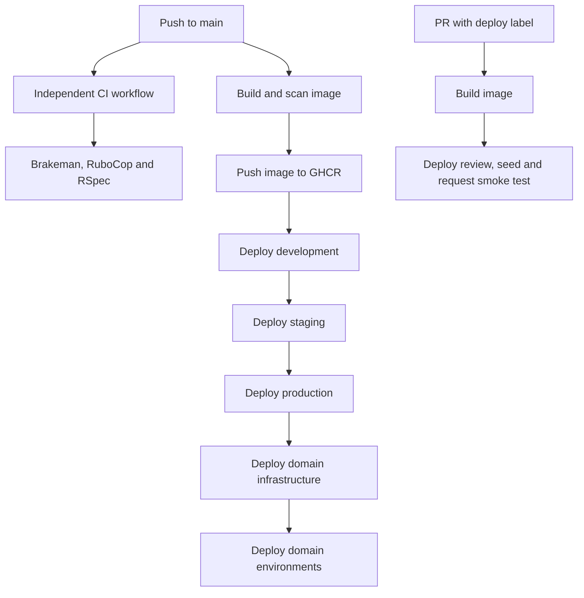

# Deployment

The service deploys container images to the DfE shared AKS platform. Rails web and Solid Queue worker workloads share configuration and a PostgreSQL database. Kamal is bundled but is not the deployment path declared here.

This guide explains repository configuration, not the current health of a live environment. Use the [recovery runbook](runbooks/recovery.md) for failed releases, maintenance and database recovery.

## Environments

| Environment | Public hostname | Cluster / namespace | Rails environment |
| --- | --- | --- | --- |
| Production | `find-placement-schools.education.gov.uk` | `production` / `bat-production` | `production` |
| Staging | `staging.find-placement-schools.education.gov.uk` | `test` / `bat-staging` | `staging` |
| Development | `development.find-placement-schools.education.gov.uk` | `test` / `bat-qa` | `az_development` |
| PR review | Generated in deployment output | `test` / `bat-qa` | `review` |

Sources: [application environment configuration](../terraform/application/config/), [domain configuration](../terraform/domains/environment_domains/config/) and [Rails environments](../config/environments/).

Staging and review load production Rails configuration. Hosted development loads development configuration. Production has two web replicas, high-availability Postgres and backup storage enabled in tfvars. These settings are not an availability or recovery commitment.

Review disables Azure backing services and database SSL, using an in-cluster database. Review deploys request seeding; seeds create personas and can call external GIAS/Publish sources. Do not copy production data into review apps.

Sign-in method is selected by `SIGN_IN_METHOD`, which is not set by the committed environment YAML. Its absence defaults to personas. Check effective configuration through the approved access process; do not assume production-style Rails settings alone guarantee DfE Sign-in.

## Release path



Arrows show workflow dependencies, not a CI-to-deployment gate. [CI](../.github/workflows/ci.yml) and [Build and Deploy](../.github/workflows/build-and-deploy.yml) are separate workflows. The deployment workflow does not depend on CI completion; branch-protection/environment approval settings are outside this source and have not been verified.

The image repository is `ghcr.io/dfe-digital/find-placement-schools`. The shared build action receives a Snyk token; the [Dockerfile](../Dockerfile) defines the build/runtime image. Environment promotion uses a matrix with `max-parallel: 1` in development, staging, production order. A failure prevents successful completion of the later deployment path.

The [migration job](../terraform/application/job.tf) defaults to `bundle exec rails db:prepare` through [Terraform variables](../terraform/application/variables.tf). Inspect shared-action output for migration and rollout results; healthy web pods do not prove every migration or worker task completed as intended.

Review deploys request smoke tests. For development, staging and production, smoke-test inputs are commented out; the configured health check is requested instead. Do not call these production browser-journey tests.

## Manual deployment and review lifecycle

The Build and Deploy workflow accepts:

- `environment`: review, development, staging or production.
- `docker-image-tag`: required tag of an existing image.
- `pull-request-number`: required for review deployments.

A manual run deploys the supplied tag without running the build job. Before dispatching, verify the image, environment, approval and database compatibility. Afterward verify `/healthcheck/sha`, database health, both workloads and a representative user journey. Do not treat image redeployment as database rollback.

PRs labelled `deploy` receive review apps. [Delete Review App](../.github/workflows/delete-review-app.yml) handles labelled PR closure or a manual PR number. [Reconciliation](../.github/workflows/review-app-reconcile.yml) runs Sunday 08:00 UTC and deletes stale review apps; a manual run defaults to dry-run. Treat review data as disposable.

[Build No Cache](../.github/workflows/build-nocache.yml) runs Sunday 12:30 UTC and builds/pushes without reusing cache. It does not itself deploy the rebuilt image.

## Infrastructure and configuration

| Location | Responsibility |
| --- | --- |
| [terraform/application](../terraform/application/) | Web, worker, migration job, database, configuration, analytics, Airbyte and uptime resources |
| [terraform/domains/infrastructure](../terraform/domains/infrastructure/) | DNS/Front Door infrastructure |
| [terraform/domains/environment_domains](../terraform/domains/environment_domains/) | Environment domains/origins, asset cached paths and rate-limit inputs |
| [global_config](../global_config/) | Subscription/environment naming and shared module selection |
| [Makefile](../Makefile) | Terraform setup/plan/apply, cluster access, maintenance and operational targets |

`application_configuration` supplies Kubernetes config maps/secrets from the environment config, Key Vault and module outputs. Do not commit credentials or paste secret output into docs. Rotation must account for consumers and rollout; this repository does not establish an approved rotation procedure.

For authorised infrastructure work, these examples target development and production respectively:

```sh
make development terraform-plan
make production terraform-plan CONFIRM_PRODUCTION=yes
```

They are **not side-effect-free local checks**: Makefile prerequisites select the Azure account, replace the local vendored module checkout and initialise/reconfigure Terraform state access before planning. Use the correct subscription, permissions and pinned tooling. Never substitute `terraform-apply` or `terraform-destroy` while following a diagnostic example.

[Validate Infra](../.github/workflows/validate-infrastructure.yml) runs daily at 07:00 UTC against production for application, domain infrastructure and domain environment plans. It sends notifications through the infrastructure Teams webhook. A scheduled plan is drift detection, not a deployment or proof of recovery.

## Release safety

Use the [testing guide](testing.md), inspect migration compatibility and verify both web and worker after release. Reverting a PR or deploying an old image cannot undo sent emails, analytics events, imports or destructive migrations. Maintenance routing and manually scaled replicas may be reset by a later Terraform deployment; reconcile the intended configuration.
