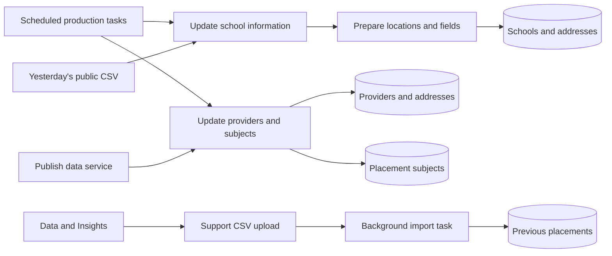
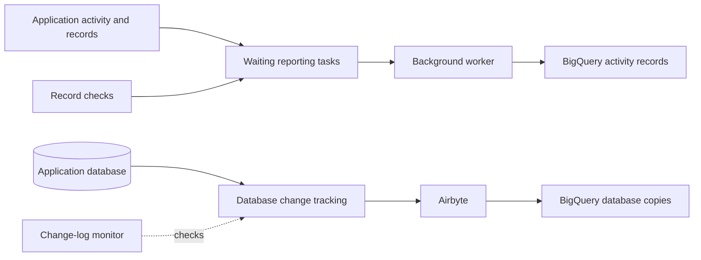

# Integrations: the other services we rely on

The service does not collect every piece of information itself. It downloads school, provider and subject details from
other services, and uses specialist services for sign-in, maps, email and reporting.

The table gives an overview. Later sections explain important limits and the technical details developers need when
changing a connection. A failed connection may leave information out of date even if the website still opens.

For developers: environment variables are named settings supplied when the application runs. When asking for help,
share the setting's **name**, never its secret value. Hosted settings come through
[Terraform](../terraform/application/application.tf); local setup uses the private file described in the [README](../README.md).

## Integration register

| Service | What we use it for | Settings and code for developers |
| --- | --- | --- |
| DfE Sign-in | Check who a user is | `SIGN_IN_METHOD`, `APP_BASE_URL`, `DFE_SIGN_IN_ISSUER_URL`, `DFE_SIGN_IN_CLIENT_ID`, `DFE_SIGN_IN_SECRET`; [OmniAuth](../config/initializers/omniauth.rb) |
| Get Information About Schools (GIAS) | Download school details and addresses | `GIAS_CSV_BASE_URL`; [GIAS services](../app/services/gias/) |
| Publish teacher training | Download provider and subject details | `PUBLISH_BASE_URL`; [Publish services](../app/services/publish_teacher_training/) |
| Register trainee teachers | Supply past-placement data through Data & Insights and a support file upload | No live API connection or Register credential for this import; [upload wizard](../app/wizards/import_previous_placements_wizard.rb) |
| Google | Show maps, turn addresses into coordinates and estimate travel times | `GOOGLE_MAPS_API_KEY`; [geocoder](../config/initializers/geocoder.rb), [Routes client](../lib/google/routes_api.rb), [map code](../app/javascript/controllers/map_controller.js) |
| GOV.UK Notify | Send emails | `NOTIFY_API_KEY`; [mail settings](../config/environments/production.rb) and [mailers](../app/mailers/) |
| GOV.UK bank holidays | Help choose email delivery dates using England/Wales holidays | No credential needed; [client](../lib/gov_uk/bank_holiday.rb) |
| DfE Analytics | Send information about service activity to BigQuery for reporting | [Setup](../config/initializers/dfe_analytics.rb), [field settings](../config/analytics.yml) and [Terraform](../terraform/application/dfe_analytics.tf) |
| Airbyte | Copy database information to BigQuery for reporting | [Terraform](../terraform/application/airbyte.tf) and data-copy settings |
| Sentry | Report application errors | `SENTRY_DSN`; [setup](../config/initializers/sentry.rb) |
| Logit / Azure monitoring | Collect logs and monitor the hosting resources | [Terraform](../terraform/application/application.tf) and environment settings |
| StatusCake | Check whether the website is available and its HTTPS certificate is valid | [Terraform](../terraform/application/statuscake.tf) and production monitoring settings |

Dashboard details, assurance reports, policies and incident guidance are maintained in Confluence and are not reproduced or linked here.

## Reference-data flow



Regular imports are scheduled only for the live production service. See [operations](operations.md#recurring-work)
for the times and what this means for test environments.

### GIAS

GIAS provides a public CSV file (a spreadsheet saved as text). We download yesterday's file, prepare its values and use
it to add or update school/address records. The import also tries to remove schools absent from the source if they
have no preferences. A refresh can therefore delete data, not just add it.

For developers: [CSVDownloader](../app/services/gias/csv_downloader.rb) requests `edubasealldataYYYYMMDD.csv`, using
ISO-8859-1 text encoding. A download failure is logged and raised as `Down::Error`.
[The job](../app/jobs/gias/sync_all_schools_job.rb) downloads, transforms, imports and removes temporary files.
It matches schools by URN and addresses by organisation ID. Linked records can prevent deletion.
The whole import is not all-or-nothing, so check what changed before trying again.

### Publish

Publish supplies providers and subjects. Providers are matched by code and added or updated; subjects include links
between a broad subject such as Modern Languages and its individual languages.

### For developers: Publish request details

The service requests these API addresses:

```text
GET {PUBLISH_BASE_URL}/api/public/v1/recruitment_cycles/{start_year}/providers
GET {PUBLISH_BASE_URL}/api/public/v1/subject_areas?include=subjects
```

The provider request uses the current academic year's start year. The response is expected to contain `data` and each
item's `attributes`. `links.next` points to another page of results. Entries without a name/code are logged and skipped.
Valid providers are added or updated using the type/code database index; addresses are updated separately.

The subject response uses `data` for subject-area links and `included` for subject details. The import adds
primary/secondary subjects and links language subjects to their parent. Invalid records can be logged and skipped,
so a completed job does not mean every subject was imported.

The [clients](../app/services/publish_teacher_training/) read responses as JSON, but do not set their own time limits,
check HTTP success codes or define when to retry. Do not assume they will automatically wait and try again if Publish
is busy; any library defaults are not a promise made by this service.

### Register

Support uploads a CSV supplied through Data & Insights. Its headings are `academic_year_start_date`, `school_urn` and
`subject_name`. The year must be four digits, not a full date. The [upload guide](runbooks/data-imports.md) explains
which rows can be skipped and how to check the results.

## Maps, geocoding and travel times

Google helps show schools on a map, find coordinates for an address (geocoding) and estimate travel times.
The browser gets its map key from an [internal address](api.md#map-key). A working map does not prove that travel-time
requests also work: they use a separate Google API with its own settings and usage allowance.

### For developers: travel requests and saved results

[RoutesAPI](../lib/google/routes_api.rb) posts to `https://routes.googleapis.com/distanceMatrix/v2:computeRouteMatrix`.
It sends the starting address, destination coordinates, travel mode and imperial units, and asks for
`localizedValues,destinationIndex` in a JSON response.

[TravelTime](../app/services/travel_time.rb) asks for DRIVE, TRANSIT and WALK times. It can reuse results for one day,
using a cache key based on the starting address, destination coordinates and mode. It expects a duration for each
destination and does not provide a fallback for missing/error entries. Production has no explicitly configured shared
cache, so separate copies of the application may each request the same information.

## Notifications and bank holidays

Notify sends emails such as invitations and reminders. Looking at an email preview does not show that an email has been
sent. Developers should check the environment's delivery settings: production-style environments and development use
Notify, while tests use test delivery. Templates are in [mailers](../app/mailers/) and previews in
[spec/mailers/previews](../spec/mailers/previews/).

The service downloads bank holidays from `https://www.gov.uk/bank-holidays.json`.
For developers: it checks for HTTP success and reads `england-and-wales.events`. A failed response raises an error;
the client does not define automatic retries.

If an email is scheduled on a known bank holiday, [BankHolidayDeliverySchedule](../config/initializers/bank_holiday_delivery_schedule.rb)
moves delivery to the start of the next working day. This is not a general rule against weekend delivery.
Restoring or rerunning old tasks can send emails again; see [recovery](runbooks/recovery.md).

## Analytics and replication

Reporting receives information in two ways. DfE Analytics sends records of activity, such as requests made to the
service. Airbyte separately copies database information. Both end up in BigQuery, Google's reporting data store.



### For developers: reporting settings and checks

DfE Analytics and Airbyte are enabled for production and staging. Analytics tasks use the `dfe_analytics` queue.
`config/analytics*.yml` controls which fields may be sent or must be hidden/blocked.
Terraform supplies the settings and identity permissions needed to connect.

The [WAL monitor](../.github/workflows/database-replication-monitor.yml) checks database change-log growth at 00:00,
06:00, 12:00 and 18:00 UTC in both environments. WAL is PostgreSQL's write-ahead log; a stalled data copy can let it grow.
The `wal_threshold` setting is 10,000,000,000.

[Fix Airbyte Replication](../.github/workflows/fix-airbyte-replication.yml) can check without changing anything in a manual
dry run. However, scheduled Sunday hourly runs from 00:00 to 09:00 default to production **and can change the database's
replication setup**. They are repair actions, not just checks.

## When a task fails or needs to run again

If a task fails, check what happened before running it again. It may already have saved some records or scheduled emails.
Mission Control, logs and the resulting records help establish where it stopped.

For developers: [ApplicationJob](../app/jobs/application_job.rb) has no enabled shared `retry_on` or `discard_on` rules.
Using Active Job alone does not mean every failed task retries automatically.
An automated script existing in the repository is also not proof it has run successfully or been tested for recovery.
