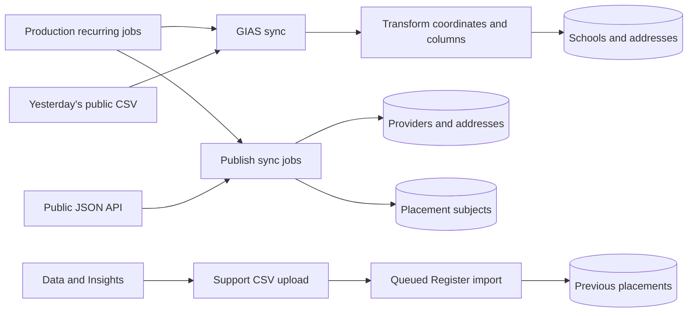
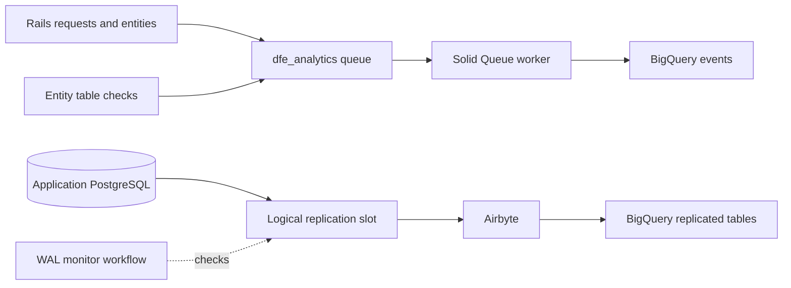

# Integrations

External sources populate school/provider reference data; other integrations support maps, notifications, analytics and operations. This is the service-side contract, not a replacement for upstream documentation or Confluence-held operational material.

Use environment variable **names**, never values, in support requests. Hosted configuration is supplied through [application configuration Terraform](../terraform/application/application.tf); local setup uses the ignored environment file described in the [README](../README.md).

## Integration register

| Integration | Direction and purpose | Configuration and implementation |
| --- | --- | --- |
| DfE Sign-in | Browser OIDC authentication | `SIGN_IN_METHOD`, `APP_BASE_URL`, `DFE_SIGN_IN_ISSUER_URL`, `DFE_SIGN_IN_CLIENT_ID`, `DFE_SIGN_IN_SECRET`; [OmniAuth](../config/initializers/omniauth.rb) |
| GIAS | Download public school CSV; transform and upsert schools/addresses | `GIAS_CSV_BASE_URL`; [GIAS services](../app/services/gias/) |
| Publish teacher training | GET provider and subject reference data | `PUBLISH_BASE_URL`; [Publish services](../app/services/publish_teacher_training/) |
| Register trainee teachers | Data & Insights supplies CSV; support uploads previous placements | No live Register API or credential in this import; [import wizard](../app/wizards/import_previous_placements_wizard.rb) |
| Google | Browser maps, server geocoding and route matrix requests | `GOOGLE_MAPS_API_KEY`; [geocoder](../config/initializers/geocoder.rb), [Routes client](../lib/google/routes_api.rb), [map controller](../app/javascript/controllers/map_controller.js) |
| GOV.UK Notify | Outbound email | `NOTIFY_API_KEY`; production [mail configuration](../config/environments/production.rb) and [mailers](../app/mailers/) |
| GOV.UK bank holidays | GET England/Wales holiday events | No service credential; [bank-holiday client](../lib/gov_uk/bank_holiday.rb) |
| DfE Analytics | Application/request/entity events to BigQuery | [initializer](../config/initializers/dfe_analytics.rb), [field configuration](../config/analytics.yml) and [Terraform](../terraform/application/dfe_analytics.tf) |
| Airbyte | Database replication into BigQuery | [Terraform](../terraform/application/airbyte.tf), stream configuration and platform-provided configuration |
| Sentry | Error reporting | `SENTRY_DSN`; [initializer](../config/initializers/sentry.rb) |
| Logit / Azure monitoring | Runtime logs and infrastructure monitoring | [application Terraform](../terraform/application/application.tf), environment infrastructure settings |
| StatusCake | Uptime/SSL checks | [StatusCake Terraform](../terraform/application/statuscake.tf), production external/apex URLs and contact-group configuration |

Dashboard details, assurance reports, policies and incident guidance are maintained in Confluence and are not reproduced or linked here.

## Reference-data flow



The recurring schedule is configured under `production` only. See [operations](operations.md#recurring-work) for exact times and environment scope.

### GIAS

[CSVDownloader](../app/services/gias/csv_downloader.rb) requests `edubasealldataYYYYMMDD.csv` for yesterday's date, sets ISO-8859-1 encoding and logs/re-raises `Down::Error`. [The job](../app/jobs/gias/sync_all_schools_job.rb) downloads, transforms, imports and then unlinks temporary files.

The importer upserts schools by URN and addresses by organisation ID. It also attempts to delete schools absent from the source with no preferences. That makes a resync a mutation with deletion effects, not a harmless read. There is no encompassing import transaction guaranteeing all-or-nothing updates; inspect progress and data before retrying.

### Publish

The service requests:

```text
GET {PUBLISH_BASE_URL}/api/public/v1/recruitment_cycles/{start_year}/providers
GET {PUBLISH_BASE_URL}/api/public/v1/subject_areas?include=subjects
```

Provider recruitment cycle uses the current academic year's start year. Provider JSON expects `data`, item `attributes` and optional `links.next` pagination. Missing name/code entries are logged and skipped. Valid providers are upserted by the provider type/code index; addresses are upserted separately.

Subject JSON expects `data` subject-area relationships and `included` subject attributes. It imports primary/secondary subjects and links modern-language children to their parent. Record-validation failures are logged inside the subject loop; job completion alone does not prove every subject was imported.

The [clients](../app/services/publish_teacher_training/) parse HTTP bodies as JSON without explicit per-request timeout, HTTP-status validation or retry configuration. Do not assume a rate-limit retry/backoff contract. Framework/library defaults are not a service-level guarantee.

### Register

This is a manual CSV handoff, with headers `academic_year_start_date`, `school_urn` and `subject_name`. The year field contains four year digits, not a full date. See the [data-import runbook](runbooks/data-imports.md) for parsing, skipped rows, queueing and verification.

## Maps, geocoding and travel times

The browser obtains its key from the [internal endpoint](api.md#map-key) and loads Google's Maps JavaScript. Server geocoding uses the Google lookup.

[RoutesAPI](../lib/google/routes_api.rb) posts to `https://routes.googleapis.com/distanceMatrix/v2:computeRouteMatrix` with origin address, destination latitude/longitude, travel mode and imperial units. It requests `localizedValues,destinationIndex`, then parses the body as JSON.

[TravelTime](../app/services/travel_time.rb) requests DRIVE, TRANSIT and WALK results. It caches each mode for one day using a hash of origin, destination coordinates and mode. The service expects matching destination entries with duration text; it has no explicit fallback for missing/error entries. A successful map-key response does not test Routes or its quota. Production does not configure a shared cache store, so do not assume one request per cache key across all replicas.

## Notifications and bank holidays

Hosted production-style environments configure Notify delivery. Development/test have their own mail behaviour; do not infer delivery from a preview. Templates are referenced in [mailers](../app/mailers/), with previews under [spec/mailers/previews](../spec/mailers/previews/).

The bank-holiday client fetches `https://www.gov.uk/bank-holidays.json`, checks for an HTTP success and reads `england-and-wales.events`. Failed HTTP responses raise; there is no explicit application retry policy in the client.

[BankHolidayDeliverySchedule](../config/initializers/bank_holiday_delivery_schedule.rb) defers `deliver_later` to the next working day's start when the enqueue date is a bank holiday. It is not a blanket rule that email is never delivered at weekends. Restoring/replaying jobs can send notifications again; use the [recovery guidance](runbooks/recovery.md).

## Analytics and replication

Application event dispatch and database replication are separate paths:



DfE Analytics is enabled for production and staging. Its queue name is `dfe_analytics`; field allow lists and hidden/blocked fields are in `config/analytics*.yml`. Terraform supplies federated authentication/configuration. Airbyte is enabled for production and staging in the environment tfvars.

The [WAL monitor](../.github/workflows/database-replication-monitor.yml) runs at 00:00, 06:00, 12:00 and 18:00 UTC for both environments; configured `wal_threshold` is 10,000,000,000. [Fix Airbyte Replication](../.github/workflows/fix-airbyte-replication.yml) supports a manual dry run, but its scheduled Sunday 00:00-09:00 hourly runs default to production **with mutation enabled**. Treat repair as an operational change, not as a read-only dashboard.

## Failure and replay boundaries

[ApplicationJob](../app/jobs/application_job.rb) contains no enabled application-wide `retry_on` or `discard_on` policy. Do not promise automatic retries just because a task runs through Active Job. Use Mission Control, logs and resulting records to establish the actual failure point.

An importer can partly update data, queue notifications or skip invalid rows. Before replay, identify its effects and compare input with current records. Operational automation existing in the repository is not proof of successful execution, retention enforcement or tested recovery.
