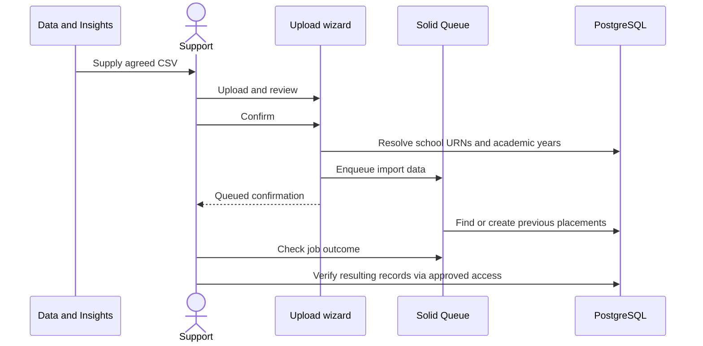

# Data imports and onboarding

Use the admin UI rather than ad-hoc console scripts. Both CSV flows enqueue work: a confirmation page is not proof that all records were imported.

Before any upload, confirm the environment, your admin access, the input's source and the expected record changes. Use synthetic files in a non-production environment to rehearse a new format. Never attach live CSVs, contact lists or session contents to repository documentation.

## Previous placements from Register

Data & Insights obtains the information; a member of support uploads the file. The request cadence and approval process have not been established here. Relevant policy material is maintained in Confluence and is not copied or linked here.

### Input contract

The CSV must be uploaded as `text/csv` and contain these exact headers:

```csv
academic_year_start_date,school_urn,subject_name
2025,999999,Example subject
```

The row is synthetic; `999999` must be replaced with an existing local school URN when rehearsing. Despite its name, `academic_year_start_date` expects **four year digits**, not `2025-09-01`. The wizard converts it into 1 September of that year and finds/creates the academic year.

Sources: [upload validation](../../app/wizards/import_previous_placements_wizard/upload_step.rb), [wizard](../../app/wizards/import_previous_placements_wizard.rb), [import service](../../app/services/register_trainee_teachers/import.rb).

### Procedure

1. Sign in as an authorised admin in the intended environment.
2. Open the previous-placement import from the admin dashboard (`/admin/previous_placements/new`).
3. Upload the agreed file. Resolve missing headers and reported year/subject errors.
4. Compare the confirmation with the intended input, then confirm once.
5. In `/jobs`, find `RegisterTraineeTeachers::ImportPlacementDataJob` and check its outcome.
6. Verify historical records for representative existing schools, years and subjects, and reconcile skipped/duplicate rows before declaring completion.



### Limitations and replay

- Rows without a school URN are excluded. Rows with an unknown school URN do not become placement records.
- Year/subject checks apply to rows with a school URN. The validation checks year format, not a business-approved range.
- The wizard resolves academic years while building job input, so it can create year records before the import job finishes.
- The importer skips nil/incomplete mapped rows. It uses `find_or_create_by` for school/year/subject; identical rows are normally reused, but the schema has no composite unique index guaranteeing deduplication under concurrency.
- There is no whole-file transaction or detailed per-row success report. Earlier rows can persist before a later failure.
- A finished job is not proof that every source row produced a record.

If work fails, establish which rows were accepted and why others were skipped before retrying. Do not run overlapping imports. Agree any correction/removal through the normal support/change process rather than deleting history to force a replay.

## Bulk user onboarding

Open the onboarding journey from the admin dashboard (`/admin/users/onboard_users`) and choose school or provider users.

School CSV:

```csv
urn,email_address,first_name,last_name
999999,school-user@example.org,Example,User
```

Provider CSV:

```csv
code,email_address,first_name,last_name
EX1,provider-user@example.org,Example,User
```

These are synthetic identifiers; use existing organisations when rehearsing. Required headers differ by organisation type. Uploads require `text/csv`; step parsers request ISO-8859-1 to UTF-8 conversion. Validate representative names/characters as well as column names.

1. Confirm the type, environment, organisation identifiers and permission to send invitations.
2. Upload, review validation errors and confirm once.
3. Check `Users::CreateCollectionJob`, then its queued mail jobs.
4. Verify a sample user's membership and reconcile intended versus resulting users. Do not use inbox delivery alone as proof that every membership was added.

The wizard checks names/email and filters blank identifiers/email. Unknown organisations are skipped when mapping rows; a CSV can therefore pass the displayed validation but omit a user. The job skips existing organisation users, finds/creates users and memberships, and queues invitations in batches of 100 with increasing minute delays.

There is no whole-file transaction. Replay may skip already-established memberships while other rows still need repair; do not assume every failed job is safe to retry or that invitations are exactly once.

Sources: [OnboardUsersWizard](../../app/wizards/onboard_users_wizard.rb), [school step](../../app/wizards/onboard_users_wizard/school_upload_step.rb), [provider step](../../app/wizards/onboard_users_wizard/provider_upload_step.rb), [collection job](../../app/jobs/users/create_collection_job.rb).

## Reference-data refresh

Production schedules import schools, providers, subjects and bank holidays. Check [operations](../operations.md#recurring-work) and the [integration contracts](../integrations.md) before initiating a manual refresh.

For an authorised operator using the approved environment console, the existing job classes are:

| Job | Writes and replay concerns |
| --- | --- |
| `GIAS::SyncAllSchoolsJob` | Downloads/transforms CSV, upserts schools/addresses, attempts deletion of absent schools without preferences; foreign keys may block deletion |
| `PublishTeacherTraining::Provider::SyncAllJob` | Upserts providers and addresses; check source pagination and partially applied batches |
| `PublishTeacherTraining::Subject::SyncAllJob` | Finds/creates subjects and links language children; validation errors can be logged without failing the entire job |
| `BankHolidays::SyncJob` | Finds/creates holiday dates; existing titles are not updated by the creation block |

Do not run these commands against production merely to test documentation. Before an approved manual run, check for an existing run, upstream availability, target environment, current data and expected write/deletion scope. Monitor the job and compare representative records afterward. A manual run in staging/review is not evidence that a recurring schedule exists there.
