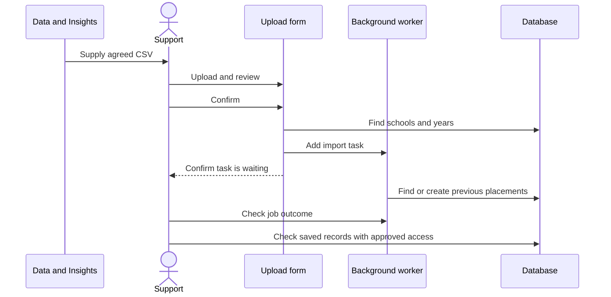

# Data imports and onboarding

This guide is for support staff uploading past-placement data or adding several users at once. Use the admin pages,
rather than a one-off script in the live application.

Both uploads add a task to a waiting list. A confirmation message means the task was queued, not that every row was
saved. Check the task and resulting records before telling someone the upload is complete.

Before uploading, confirm the environment, your admin access, where the file came from and what should change.
Practise a new format with made-up data outside production. Keep real files and contact lists out of repository docs.

## Previous placements from Register

Data & Insights gets the information and support uploads it. We still need to confirm how often to request it and who
approves the handoff. Relevant policies stay in Confluence, without copies or links here.

### File format

A CSV is a spreadsheet saved as plain text with commas between columns. It needs these exact column headings:

```csv
academic_year_start_date,school_urn,subject_name
2025,999999,Example subject
```

The row is made up. When practising, replace `999999` with a school URN (school number) in your local test data.
Despite its name, `academic_year_start_date` expects **four year digits**, not `2025-09-01`.
The form turns that into 1 September and finds or creates the academic year.

For developers: the upload checks the file's content type is `text/csv`. If a genuine CSV is rejected, check the type
reported by the browser as well as the filename.

Sources: [upload validation](../../app/wizards/import_previous_placements_wizard/upload_step.rb), [wizard](../../app/wizards/import_previous_placements_wizard.rb), [import service](../../app/services/register_trainee_teachers/import.rb).

### Procedure

1. Sign in as an authorised admin in the intended environment.
2. Open the previous-placement import from the admin dashboard (`/admin/previous_placements/new`).
3. Upload the agreed file. Resolve missing headers and reported year/subject errors.
4. Compare the confirmation with the intended input, then confirm once.
5. In `/jobs`, find `RegisterTraineeTeachers::ImportPlacementDataJob` and check its outcome.
6. Check a sample of saved placements against the file, covering different schools, years and subjects.
   Account for skipped or duplicate rows before marking the work complete.



### Skipped rows and trying again

- Rows without a school URN are excluded. Rows with an unknown school URN do not become placement records.
- The form checks year/subject values for rows with a school URN. It checks the year has four digits, not that the
  year is appropriate for the upload.
- Preparing the task can create academic-year records before the task finishes.
- Empty or incomplete prepared rows are skipped. Identical school/year/subject records are normally reused, but the
  database does not guarantee duplicates are prevented if imports overlap.
- Saving is not all-or-nothing. Earlier rows can remain saved if a later row fails, and there is no detailed
  per-row success report.
- A finished job is not proof that every source row produced a record.

If it fails, check what was saved and why rows were skipped before trying again. Do not run imports over each other.
Agree corrections through the normal support process rather than deleting history to make a repeat upload work.

## Bulk user onboarding

Open the onboarding journey from the admin dashboard (`/admin/users/onboard_users`) and choose school or provider users.

School CSV:

```csv
urn,email_address,first_name,last_name
999999,school-user@example.org,Example,User
```

Provider CSV:

```csv
code,email_address,first_name,last_name
EX1,provider-user@example.org,Example,User
```

These examples are made up; use organisations that exist in your test data when practising. School files need a URN;
provider files need a provider code. Check names with accented or other special characters as well as the headings.

For developers: the file must report `text/csv`. The readers request ISO-8859-1 to UTF-8 text conversion, so check
the source file's encoding if names are garbled.

1. Confirm the type, environment, organisation identifiers and permission to send invitations.
2. Upload, review validation errors and confirm once.
3. Check `Users::CreateCollectionJob`, then its queued mail jobs.
4. Check sample users' memberships and compare the expected users with those added. An invitation arriving in an
   inbox is not proof that every membership was added.

The form checks names and email addresses, but skips rows with blank identifiers/email or unknown organisations.
A file can therefore pass the displayed checks but still omit a user. The background task skips people already linked
to the organisation, adds users/memberships as needed and schedules invitation batches of 100 a minute apart.

The upload is not all-or-nothing. Running it again may skip memberships already added while other rows still need
fixing. Check before retrying: failed tasks are not always safe to repeat and emails are not guaranteed to send once only.

Sources: [OnboardUsersWizard](../../app/wizards/onboard_users_wizard.rb), [school step](../../app/wizards/onboard_users_wizard/school_upload_step.rb), [provider step](../../app/wizards/onboard_users_wizard/provider_upload_step.rb), [collection job](../../app/jobs/users/create_collection_job.rb).

## Reference-data refresh

The live service regularly downloads schools, providers, subjects and bank holidays.
Check [scheduled tasks](../operations.md#recurring-work) and [connections](../integrations.md) before requesting a manual
refresh. A refresh can change or remove information.

### For developers/operators: available tasks

With approved access to the intended environment, the task names to look for are:

| Job | What it changes and what to check |
| --- | --- |
| `GIAS::SyncAllSchoolsJob` | Adds/updates schools and addresses; tries to delete missing schools with no preferences. Linked records may prevent deletion. |
| `PublishTeacherTraining::Provider::SyncAllJob` | Adds/updates providers and addresses. Check every page of source results was read and whether some records were already saved. |
| `PublishTeacherTraining::Subject::SyncAllJob` | Adds subjects and links languages to their parent subject. Invalid records can be logged/skipped without failing the task. |
| `BankHolidays::SyncJob` | Adds holiday dates if missing. It does not update the title of an existing date. |

Do not run a production task just to test these instructions. Before an approved run, check that it is not already
running, its source is available, and you understand which environment and records it will affect.
Watch the result and check sample records afterwards. A successful manual run in staging/review does not mean
it is scheduled to run there automatically.
