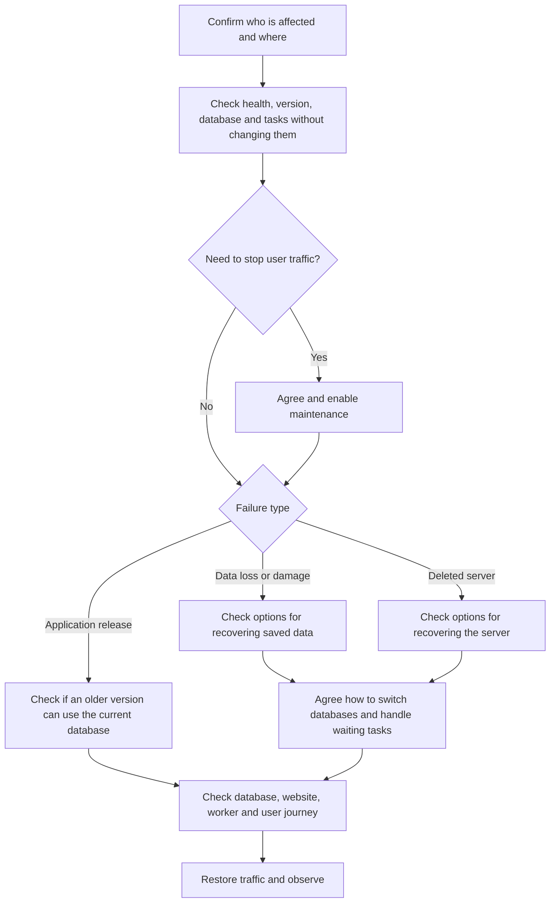

# Maintenance and recovery

This guide helps developers and operators choose what to do when a release fails or data is lost.
It explains the available tools and what still needs to be agreed before using them. It is not a tested,
ready-to-run recovery plan. Support commitments, maximum acceptable recovery time (RTO) and acceptable data loss
(RPO) are not agreed.

Incident guidance stays in Confluence, without copies or links here. Agree who is authorised to lead the change
before changing a live service.

## Choose the recovery path



Showing a maintenance page does not stop background tasks or undo things such as emails already sent.

## Before making changes

- Check the Azure account (subscription), hosting group/area (cluster/namespace), environment and database.
- Find the running application version, which database changes have run, who is affected and the point you want to recover to.
- Agree an owner and approver. Coordinate other releases, imports and scheduled tasks so they do not conflict.
- Decide what data could be lost, which tasks/emails might repeat and how you will check the result.
- Read the workflow and the shared tools it calls before starting. Shared actions use their `master` branch, so they
  can change separately from this repository.
- Practise an untested procedure in a separate non-production environment with approved, made-up data before relying on it.

## Maintenance mode

[Set maintenance mode](../../.github/workflows/maintenance.yml) accepts `environment` (`development` or `production`) and `mode` (`enable` or `disable`). It routes traffic through the shared maintenance action.

The [Makefile](../../Makefile) also offers these production commands, **only after authorisation**:

```sh
make production enable-maintenance CONFIRM_PRODUCTION=yes
make production disable-maintenance CONFIRM_PRODUCTION=yes
```

### For developers/operators: what the commands change

Enabling maintenance builds/stores a maintenance-page package and points incoming requests at it. Disabling it points
requests back to the application. You need the right GitHub/Azure permissions and token settings.
Both commands fetch hosting credentials and change your local Kubernetes connection settings (`kubeconfig`).
Never put tokens in commands recorded in documentation.

Check the public website shows maintenance, then check normal service after disabling it. A later Terraform release
can reset routing unless its saved settings also include maintenance mode.

## Failed application release

The previous handover described undoing the failing pull request and releasing that change through the usual process.
The [Build and Deploy workflow](../../.github/workflows/build-and-deploy.yml) can also release an already-built version,
identified by `docker-image-tag`.

Before choosing either:

1. Check whether database updates (migrations) or imports have changed saved data.
2. Check the older application can still read/write the current database.
3. Account for emails already sent, reporting events and tasks still running.
4. Agree how to handle users during the release, then follow the approved release process.
5. Check the version, database, website/worker and example school/provider/admin journeys before letting users back in.

Undoing code or releasing an older package does not undo database changes. Do not automatically reverse migrations
or restore yesterday's database just to fix faulty code: that could lose valid work.

## Backups

[Backup database to Azure storage](../../.github/workflows/backup-db.yml) runs production daily at 04:00 UTC and supports manual development/staging/production selection.

- Scheduled base name: `fps_{CONFIG_SHORT}_YYYY-MM-DD`.
- Manual default base name: `fps_{CONFIG_SHORT}_adhoc_YYYY-MM-DD`.
- The tool receives a `.sql` filename. Check the file actually saved, including whether it is compressed, before restoring.
- `db-server` lets you choose another server, such as one recovered to an earlier time. Give its backup a distinct name.

Before recovering, check that the backup really succeeded, that the saved file can be read, and that its time and source
environment are right. A schedule or enabled storage does not prove a usable backup exists. We have not established
how long backups must be kept or evidence of a successful restore test here.

## Restore mechanisms

| Workflow | What it asks for and does | Important limit |
| --- | --- | --- |
| [Logical restore](../../.github/workflows/postgres-restore.yml) | Environment and optional `backup-file`; loads a saved database file from Azure storage | Can replace data at the target. Choose a real, checked backup file, not an example filename. |
| [Point-in-time restore](../../.github/workflows/postgres-ptr.yml) | Environment, UTC `restore-time`, optional `new-db-server`; recovers to a time on a separate server, named with `-ptr` by default | Does not switch the application to that new server. |
| [Deleted-server recovery](../../.github/workflows/restore-deleted-postgres.yml) | Environment, `deleted-server`, UTC `restore-time`; asks for a time at least ten minutes after deletion | Check resource names and what the shared tool does before using it. |

All three require `confirm-production` set to the text `true` for production. This extra check does not replace approval.

### Known configuration gaps: resolve before relying on these workflows

- Restore selectors offer `development`, `test`, `production`, while this repository's environment files define `development`, `staging`, `review`, `production`, not `test`. Do not choose `test` as an assumed synonym for staging.
- Deleted-server recovery uses `RESOURCE_NAME_PREFIX` to work out the resource group, but the environment files use
  `AZURE_RESOURCE_PREFIX`. Check the actual setting and target group before starting.
- Logical restore defaults to today's `.sql.gz` name, while backup passes a `.sql` name to its shared tool. Check
  the stored file's name and compression rather than guessing.
- There is no complete procedure here for switching the application to a recovered database, updating its connection
  settings/secrets, checking network access and bringing Terraform's saved settings back into line.

These are existing limitations, not fixes. Do not assume the workflows are ready to recover the service without supervision.

## Validate and resume after data recovery

Agree how to switch databases with the platform/change owner first. With approved access, check:

1. The right database was recovered, to the right time, with the expected structure and sample records.
2. Which saved browser sessions and waiting background tasks came back with it.
3. Whether workers should stay stopped while you decide which old tasks are safe to run.
4. That the website, worker and database-update tasks can connect to the intended database.
5. `/healthcheck/database`, the running code version, sign-in/organisation choice, and example preference/search journeys.
6. Email, school/provider reference data and reporting results, without simply repeating all old tasks.
7. That requests reach the intended service and Terraform settings match it. Watch the service after letting users back in.

School/provider reference information can often be downloaded again, but school updates can delete records and imports
can partly complete before failing. Follow the [import guide](data-imports.md), not a blanket "retry all jobs" instruction.

Record what happened and any remaining risks through the team's incident/change process.
Do not say disaster recovery is tested until a rehearsal for this service provides evidence.
