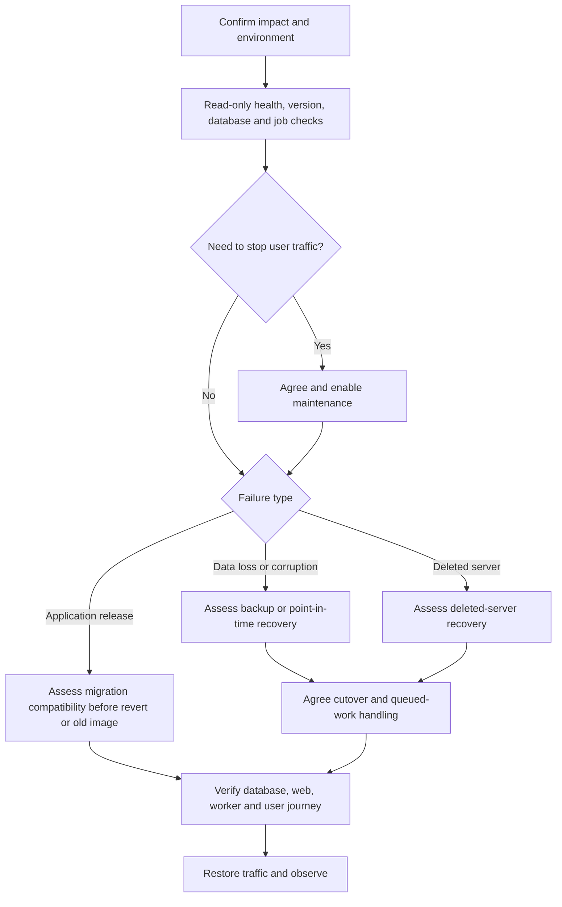

# Maintenance and recovery

This guide identifies repository-supported recovery mechanisms and their limits. It is not evidence of a rehearsed recovery or an approved cutover procedure. Support commitments, RTO and RPO are not agreed.

Incident guidance and associated operational material are maintained in Confluence and are not reproduced or linked here. Obtain an authorised change owner before mutating live services.

## Choose the recovery path



Maintenance routing does not by itself stop workers or undo external side effects.

## Preconditions for any mutation

- Confirm subscription, cluster, namespace, Rails environment and application/database identity.
- Establish the currently deployed image, migration state, impact and intended recovery point.
- Identify an owner and approver; coordinate concurrent deploys/imports and scheduled work.
- Identify what data/jobs/emails/events could be lost or replayed and how the outcome will be checked.
- Verify the exact workflow/action implementation and inputs before dispatch. Shared actions are referenced at `master`, so their behaviour may change independently of this repository.
- Rehearse in a suitable isolated non-production environment using approved synthetic data before relying on an untested procedure.

## Maintenance mode

[Set maintenance mode](../../.github/workflows/maintenance.yml) accepts `environment` (`development` or `production`) and `mode` (`enable` or `disable`). It routes traffic through the shared maintenance action.

The [Makefile](../../Makefile) also offers these production commands, **only after authorisation**:

```sh
make production enable-maintenance CONFIRM_PRODUCTION=yes
make production disable-maintenance CONFIRM_PRODUCTION=yes
```

Enable builds/pushes the maintenance image and changes routing; it needs the required GitHub/Azure permissions and token configuration. Disable changes routing back. Both fetch cluster credentials and affect local kubeconfig. Never paste tokens into a command recorded in documentation.

Verify the maintenance page from the public route, and verify normal service after disabling it. A later Terraform deployment can reset routing unless maintenance is represented in the deployment configuration.

## Failed application release

The previous handover reports reverting the failing PR through the normal pipeline as the team's approach. The [Build and Deploy workflow](../../.github/workflows/build-and-deploy.yml) also accepts an existing `docker-image-tag` for manual deployment.

Before choosing either:

1. Check whether migrations/imports have changed persisted data.
2. Confirm the earlier application and current schema/data are compatible.
3. Account for already-sent mail, analytics events and in-progress jobs.
4. Agree release/traffic handling, then use the normal approved deployment mechanism.
5. Verify the version, database health, web/worker workloads and representative school/provider/admin access before restoring normal traffic.

A Git revert or old image does not reverse database changes. Do not automatically run down-migrations or restore yesterday's database to fix a code-only failure.

## Backups

[Backup database to Azure storage](../../.github/workflows/backup-db.yml) runs production daily at 04:00 UTC and supports manual development/staging/production selection.

- Scheduled base name: `fps_{CONFIG_SHORT}_YYYY-MM-DD`.
- Manual default base name: `fps_{CONFIG_SHORT}_adhoc_YYYY-MM-DD`.
- The action is passed a `.sql` filename; the actual stored/compressed artifact must be checked before restore.
- `db-server` permits a different server, such as a point-in-time restored server; supply an explicit backup name to distinguish it.

Before recovery, verify the actual successful run, storage artifact, timestamp, source environment and readability. A cron expression or enabled backup storage is not backup evidence. This repository does not establish an agreed retention period or successful restore test.

## Restore mechanisms

| Workflow | Inputs and intended effect | Important limit |
| --- | --- | --- |
| [Logical restore](../../.github/workflows/postgres-restore.yml) | Environment and optional `backup-file`; restores an Azure-storage dump through a shared action | Treat as destructive to the selected target. Select an actual artifact, not an illustrative filename. |
| [Point-in-time restore](../../.github/workflows/postgres-ptr.yml) | Environment, UTC `restore-time`, optional `new-db-server`; default new name ends `-ptr` | Creates a separate server. This workflow does not define application cutover. |
| [Deleted-server recovery](../../.github/workflows/restore-deleted-postgres.yml) | Environment, `deleted-server`, UTC `restore-time`; input description requires at least ten minutes after deletion | Resource naming and shared-action behaviour need verification before use. |

All three gate production execution on `confirm-production` set to the string `true`. This is a workflow input guard, not a substitute for organisational approval.

### Known configuration gaps: resolve before relying on these workflows

- Restore selectors offer `development`, `test`, `production`, while this repository's environment files define `development`, `staging`, `review`, `production`, not `test`. Do not choose `test` as an assumed synonym for staging.
- Deleted-server recovery builds its resource group with `RESOURCE_NAME_PREFIX`; committed environment shell files use `AZURE_RESOURCE_PREFIX`. Verify the effective variable/resource group before dispatch.
- The logical restore default uses today's `.sql.gz` name; backup passes `.sql` to its shared action. Inspect the actual stored filename/compression rather than guessing.
- A complete point-in-time cutover, secret/configuration update, networking verification and Terraform reconciliation procedure is not defined here.

These are documentation of existing limitations, not fixes or a claim that the workflows are ready for unattended recovery.

## Validate and resume after data recovery

Agree the missing cutover details with the platform/change owner first. Then verify, through approved access:

1. The recovered database identity, recovery point, schema and representative business records.
2. Which session and Solid Queue records were restored with business data.
3. Whether worker processing should remain stopped while deciding which jobs may replay.
4. Connectivity/configuration for the intended database from web, worker and migration workloads.
5. `/healthcheck/database`, deployed SHA, sign-in/organisation choice and representative preference/search journeys.
6. Email, reference-data and analytics/replication effects, without blindly replaying old work.
7. Intended traffic routing and Terraform state/configuration, followed by observation after resuming.

Reference data can often be re-imported, but school sync includes deletion attempts and imports are not universally atomic. Follow the [import runbook](data-imports.md), not a blanket "retry all jobs" instruction.

Record the actual outcome and unresolved risks through the team's incident/change process. Do not state that DR is tested until a service-specific rehearsal has supplied evidence.
